# IAM Lab

Hands-on Identity and Access Management (IAM) lab. This repo shows my progress through the lab with screenshots of each step.

## Progress

Screenshots are stored in [`screenshots/`](screenshots/) and listed here in order.

| # | Step | Screenshot |
|---|------|------------|
| 1 | **Explore IAM users** — The IAM console lists 4 users. `awsstudent` (path `/`) is the lab login, and its details show "Access denied" because it can't view itself. `user-1`, `user-2` and `user-3` are under path `/spl66/`. Each has 0 groups, a 6-minute-old password and an active access key. |  |
| 2 | **Add user-1 to the S3-Support group** — On `user-1`, choose "Add user to groups". Of the three groups, select `S3-Support` (it has `AmazonS3ReadOnlyAccess`). The other two are `EC2-Support` (`AmazonEC2ReadOnlyAccess`) and `EC2-Admin` (no managed policy). | 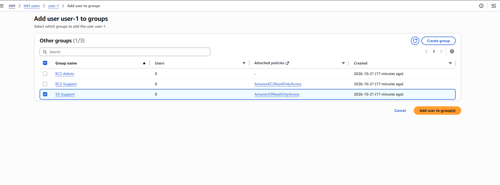 |
| 3 | **Confirm the group membership** — A banner says "User added to group S3-Support". On the `user-1` summary, the Groups tab lists `S3-Support` with `AmazonS3ReadOnlyAccess`, so `user-1` now has read-only access to S3 through the group. | 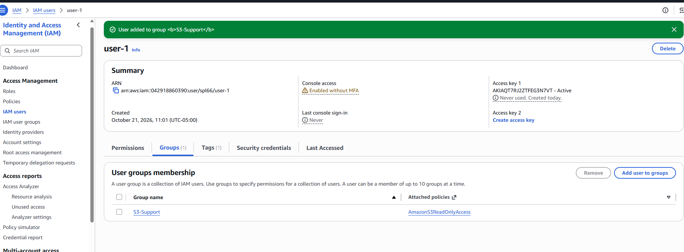 |
| 4 | **Add user-2 to the EC2-Support group** — On `user-2`, choose "Add user to groups" and select `EC2-Support`. This gives `user-2` read-only access to EC2 (`AmazonEC2ReadOnlyAccess`). | 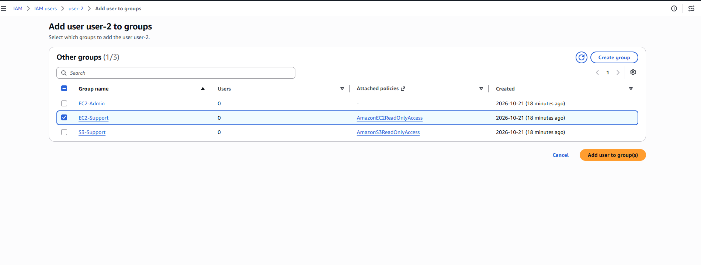 |
| 5 | **Confirm the group membership** — A banner says "User added to group EC2-Support". On the `user-2` summary, the Groups tab lists `EC2-Support` with `AmazonEC2ReadOnlyAccess`. | 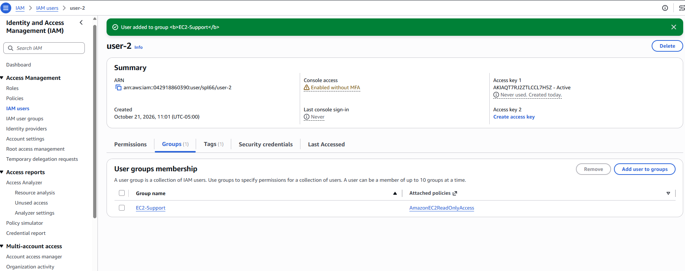 |
| 6 | **Add user-3 to the EC2-Admin group** — On `user-3`, choose "Add user to groups" and select `EC2-Admin`. This group shows no managed policy in the list. Its permissions come from an inline policy, which allows more EC2 actions than read-only. | 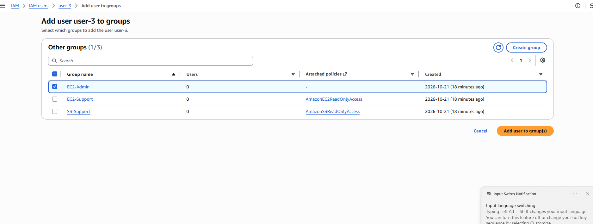 |
| 7 | **Confirm the group membership** — A banner says "User added to group EC2-Admin". On the `user-3` summary, the Groups tab lists `EC2-Admin`. Its Attached policies column shows `-` because the group has no managed policy. Now each of the three users belongs to one group. | 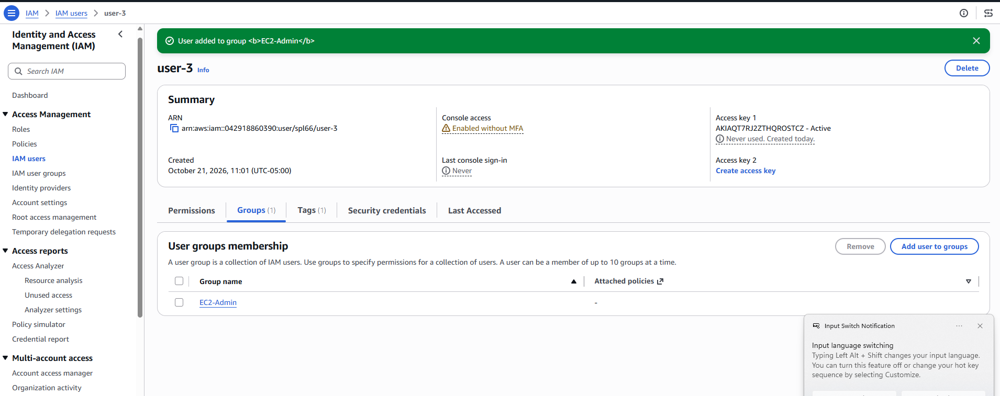 |
| 8 | **Copy the IAM user sign-in URL** — Go back to the IAM Dashboard, which shows 3 user groups, 4 users, 17 roles and 1 policy. Copy the account's sign-in URL for IAM users ("Sign-in URL copied"). You'll use it to sign in as each user and test what they can access. | 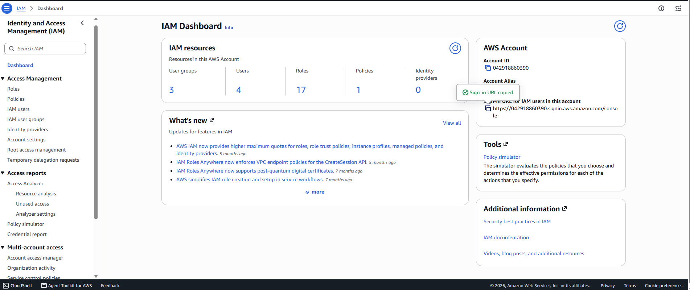 |
| 9 | **Open the sign-in URL in a private window** — Paste the IAM user sign-in URL into a new Incognito window. A private window keeps your admin session separate, so you can sign in as a test user without logging out. | 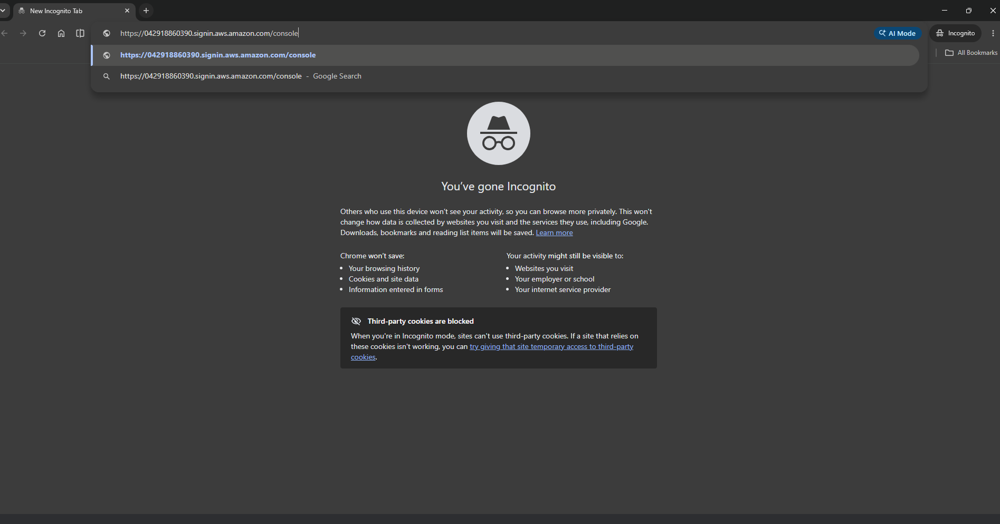 |
| 10 | **Sign in as user-1 and open S3** — Now signed in as `user-1` (top-right corner), search the console for `s3`. On the console home, widgets like AWS Health say "You don't have permissions" or "Access denied", because `user-1` only has S3 read access. | 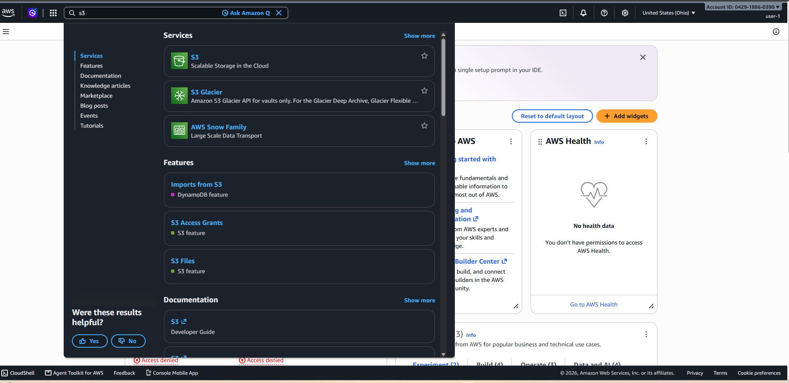 |
| 11 | **user-1 can view S3 buckets** — The S3 console lists one bucket, `samplebucket--992d9430`. This works because the `S3-Support` group gives `user-1` the `AmazonS3ReadOnlyAccess` policy. | 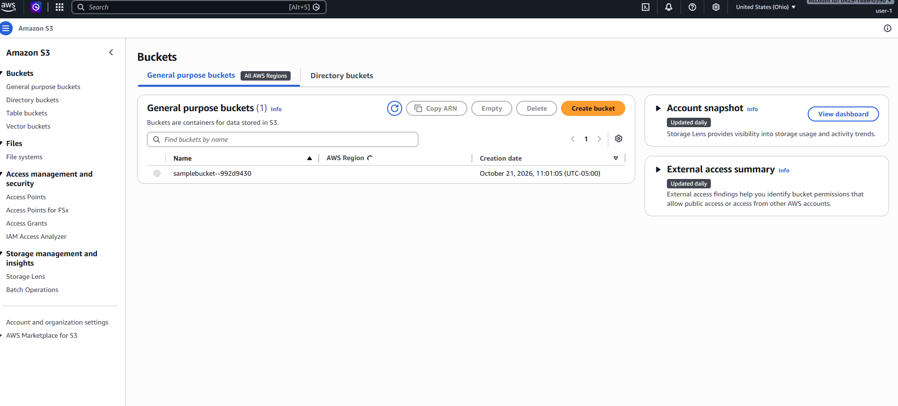 |
| 12 | **user-1 is blocked from EC2** — On the EC2 dashboard, nearly every resource shows "Access denied". For example, `user-1` lacks `ec2:DescribeAccountAttributes` and `ec2:DescribeAvailabilityZones`. Its only group, `S3-Support`, grants nothing for EC2, which shows least privilege at work. | 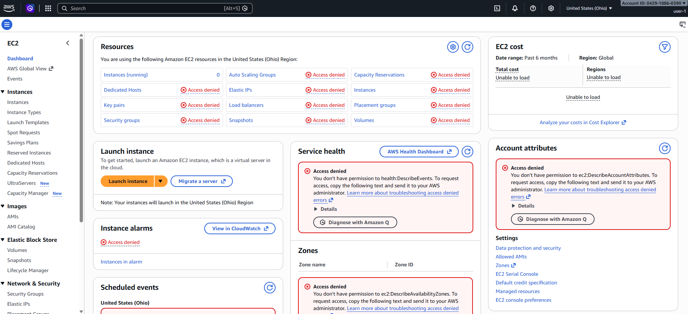 |
| 13 | **Sign out of user-1** — Open the account menu (top right), which confirms the IAM user is `user-1`, and choose **Sign out**. Next you sign in as `user-2` to test the EC2 read-only permissions. | 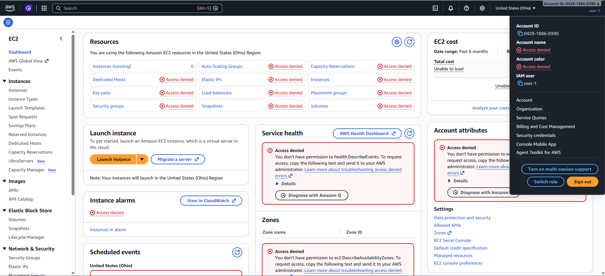 |
| 14 | **Sign in as user-2** — The console's top-right corner now shows `user-2`, confirming you're signed in as the `EC2-Support` member. | 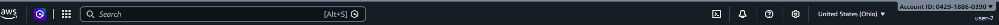 |
| 15 | **Open the EC2 dashboard as user-2** — The dashboard still shows "Access denied" on most resources. This may be the page left over from `user-1`'s session before a refresh, because `user-2` has `AmazonEC2ReadOnlyAccess` and should be able to see these. | 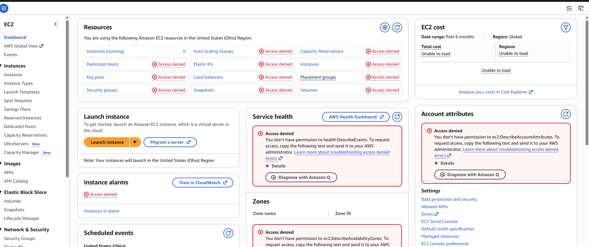 |
