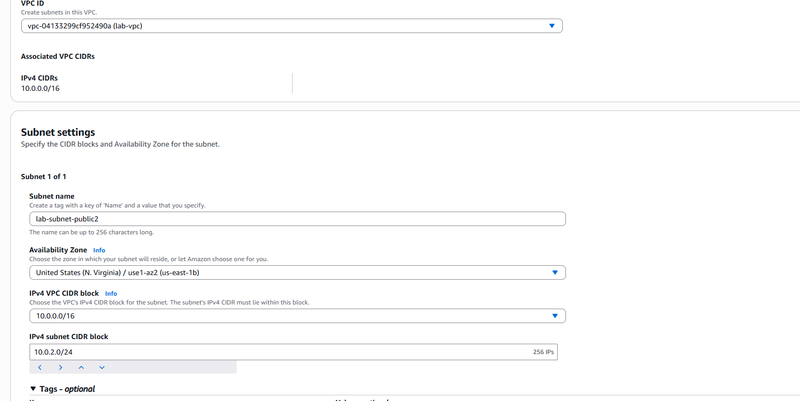
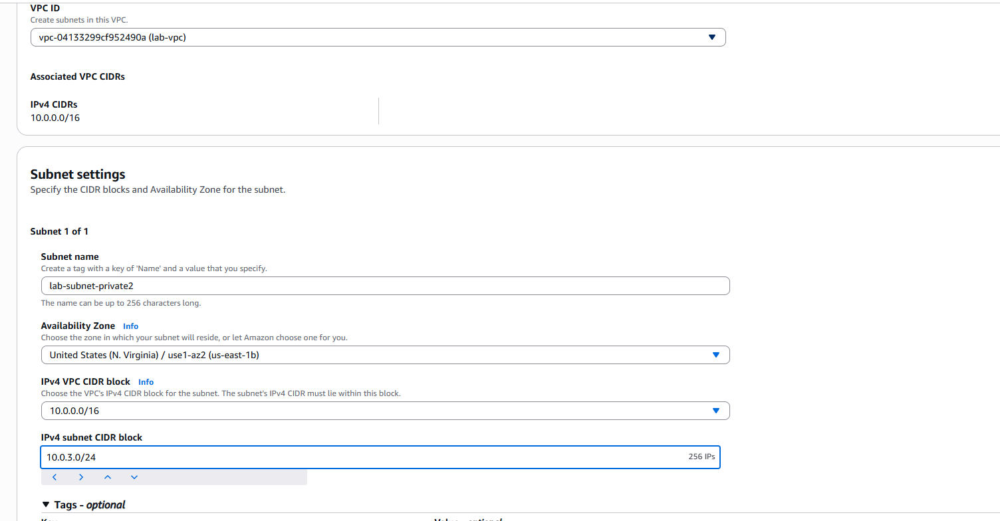
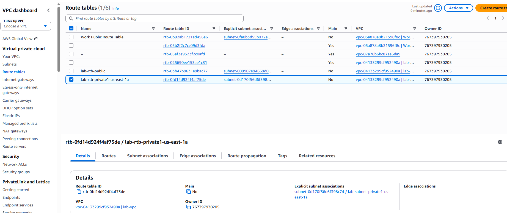
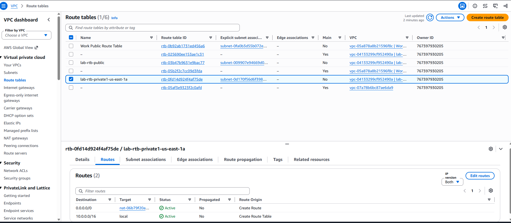
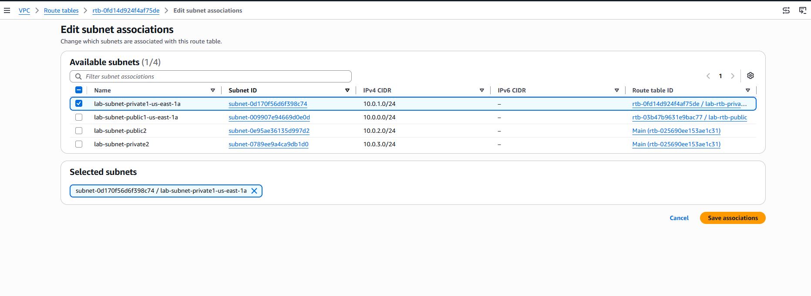
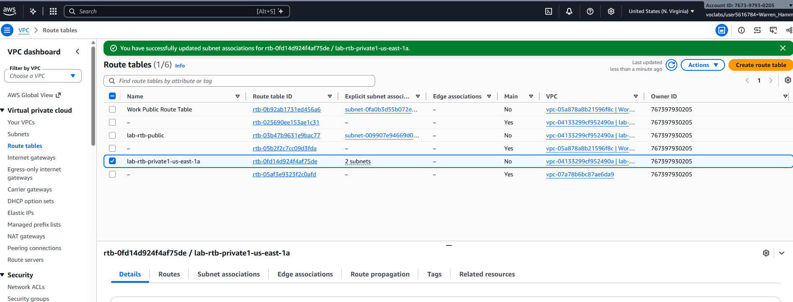
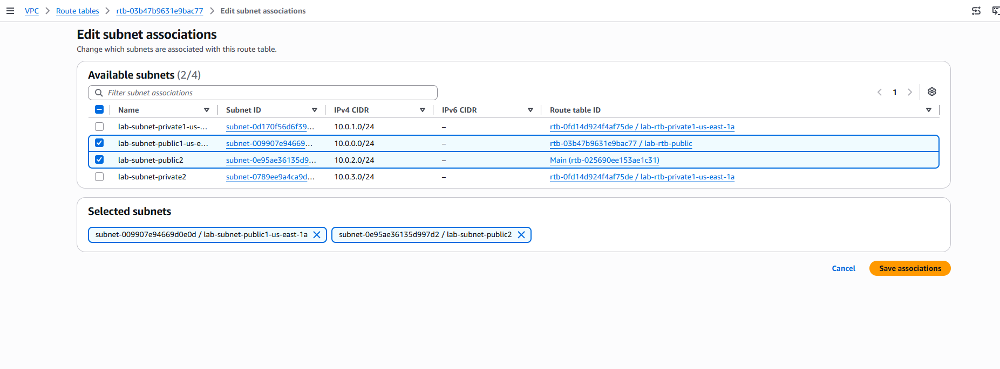

# Lab 2: Build a VPC and Launch a Web Server

Hands-on AWS networking lab. I build a custom Amazon VPC with public and private subnets across two Availability Zones, control traffic with route tables and a security group, and launch a web server on Amazon EC2. Region: US East (N. Virginia).

## What I'm building

| Resource | Details |
|----------|---------|
| VPC | `lab-vpc`, CIDR `10.0.0.0/16` |
| Public subnet 1 | `10.0.0.0/24`, Availability Zone A |
| Private subnet 1 | `10.0.1.0/24`, Availability Zone A |
| Public subnet 2 | `10.0.2.0/24`, Availability Zone B |
| Private subnet 2 | `10.0.3.0/24`, Availability Zone B |
| Internet gateway | Lets the public subnets reach the internet |
| NAT gateway | In public subnet 1; lets private subnets reach the internet without being reachable from it |
| Public route table | `10.0.0.0/16` → local, `0.0.0.0/0` → internet gateway |
| Private route table | `10.0.0.0/16` → local, `0.0.0.0/0` → NAT gateway |
| Security group | Allows HTTP to the web server |
| EC2 instance | Web Server 1, in public subnet 2 |

## Steps

> I completed this lab once without taking screenshots, then rebuilt parts of it to capture them. Steps without a screenshot describe what I built.

### 1. Create the VPC with "VPC and more"
In the VPC console, I used the **VPC and more** option to create several resources at once, with the name prefix `lab`:
- A VPC with the IPv4 CIDR block `10.0.0.0/16`
- One Availability Zone, with one public subnet (`10.0.0.0/24`) and one private subnet (`10.0.1.0/24`)
- An internet gateway, plus a NAT gateway in the public subnet
- A public route table that sends internet traffic (`0.0.0.0/0`) to the internet gateway, and a private route table that sends it to the NAT gateway

What makes the first subnet **public** is its route table, which points internet traffic at the internet gateway. Instances in the **private** subnet reach the internet through the NAT gateway, but the internet can't start connections to them.

### 2. Add subnets in a second Availability Zone
I created two more subnets in Availability Zone B, a public one (`10.0.2.0/24`) and a private one (`10.0.3.0/24`). Spreading subnets across two Availability Zones means the design keeps working if one zone has an outage, which is the basis of **high availability**.

Creating `lab-subnet-public2` in `lab-vpc`, in `us-east-1b`, with the CIDR block `10.0.2.0/24` (256 IP addresses):

Creating `lab-subnet-private2` in the same zone (`us-east-1b`) with `10.0.3.0/24`:

### 3. Associate the new subnets with route tables
I associated the new public subnet with the public route table and the new private subnet with the private route table. Each new subnet now follows the same rules as its matching subnet in Availability Zone A.

Before the change, `lab-rtb-private1-us-east-1a` has only one explicit subnet association, `lab-subnet-private1-us-east-1a`. `lab-rtb-public` also has just one:

The **Routes** tab of `lab-rtb-private1-us-east-1a` shows why its subnets are private: `10.0.0.0/16` stays inside the VPC (`local`), and all other traffic (`0.0.0.0/0`) goes to the NAT gateway, not an internet gateway. Any subnet associated with this table follows these routes:

On the **Edit subnet associations** page, the Route table ID column shows that the two new subnets (`lab-subnet-public2` and `lab-subnet-private2`) are using the VPC's **Main** route table. Any subnet without an explicit association falls back to the main table, so each new subnet needs to be associated with the right table:

After I added `lab-subnet-private2` and saved, a banner confirms the update, and `lab-rtb-private1-us-east-1a` now lists **2 subnets**. Both private subnets now send internet traffic through the NAT gateway:

Then I did the same for `lab-rtb-public`, selecting both `lab-subnet-public1-us-east-1a` and `lab-subnet-public2`. The table also confirms that `lab-subnet-private2` now belongs to the private route table:

### 4. Create a security group for the web server
I created a security group in `lab-vpc` that allows inbound HTTP traffic, so people can reach the web server from a browser. A security group works like a firewall on the instance itself: it blocks any inbound traffic you haven't allowed.

### 5. Launch the web server
I launched an EC2 instance, **Web Server 1**, in the second public subnet (`10.0.2.0/24`) with the web security group attached, then opened its public address in a browser to confirm the web page loaded.

### 6. Submit
I submitted the lab for grading and ended the session.

## Key takeaways

- **Public vs. private is set by routing.** A subnet is public only because its route table sends `0.0.0.0/0` to an internet gateway.
- **NAT gateways allow outbound-only internet access.** Private instances can download updates without being exposed to the internet.
- **Use multiple Availability Zones for high availability.**
- **Security groups add a layer of defense.** Even in a public subnet, an instance accepts only the traffic its security group allows.
